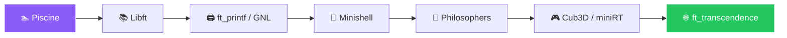

<!-- ========================= HEADER ========================= -->
<div align="center">


<a href="https://git.io/typing-svg">
  
</a>

<br/>


<br/><br/>

<a href="https://linkedin.com/in/your-username"></a>
<a href="https://your-portfolio.com"></a>
<a href="mailto:your.email@example.com"></a>

</div>

<br/>

<!-- ========================= ABOUT ========================= -->
## ✨ About Me

<table>
<tr>
<td width="60%" valign="top">

I'm a **Full Stack Developer** and a student at **1337 (42 Network)**, where learning is peer-to-peer and project-based. No teachers, no lectures: just real problems, real deadlines and a community that pushes you to grow.

I enjoy building products end to end, from a polished UI to a solid API and database, and I care about clean, readable and maintainable code.

```js
const me = {
  role: "Full Stack Developer",
  school: "1337 / 42 Network 🇲🇦",
  currentlyBuilding: "[your current project]",
  currentlyLearning: ["TypeScript", "Docker", "System Design"],
  funFact: "I debug with console.log and I'm not ashamed 😅",
  lookingFor: "Internships & exciting collaborations",
};
```

</td>
<td width="40%" valign="top">

### 🎯 Quick Facts

- 🔭 Working on **[your project]**
- 🌱 Learning **Docker & TypeScript**
- 🤝 Open to **internships & open source**
- 💬 Ask me about **React, Node.js & C**
- 📍 Based in **Morocco 🇲🇦**
- ⚡ Fast learner, team player

</td>
</tr>
</table>

<br/>

<!-- ========================= TECH STACK ========================= -->
## 🛠️ Tech Stack

<div align="center">

**Frontend**


**Backend**


**Databases**


**Systems & Low-level (1337)**


**Tools & DevOps**


</div>

<br/>

<!-- ========================= PROJECTS ========================= -->
## 🚀 Featured Projects

<table>
<tr>
<td width="50%" valign="top">

### 📦 [Project One]
Short description of the project, the problem it solves and what makes it special.


[🔗 Live Demo](#) · [📂 Source Code](#)

</td>
<td width="50%" valign="top">

### 🛒 [Project Two]
Short description of the project, the problem it solves and what makes it special.


[🔗 Live Demo](#) · [📂 Source Code](#)

</td>
</tr>
<tr>
<td width="50%" valign="top">

### 💬 [Project Three]
Short description of the project, the problem it solves and what makes it special.


[🔗 Live Demo](#) · [📂 Source Code](#)

</td>
<td width="50%" valign="top">

### 🐚 Minishell
A Unix shell written in C: parsing, pipes, redirections, signals and environment handling.


[📂 Source Code](#)

</td>
</tr>
</table>

<div align="center">

[](https://github.com/your-username?tab=repositories)

</div>

<br/>

<!-- ========================= 1337 ========================= -->
## 🎓 My 1337 Journey



> *Edit this path to match the projects you've actually completed.*

<br/>

<!-- ========================= STATS ========================= -->
## 📊 GitHub Stats

<div align="center">


<br/>


<br/><br/>


</div>

<br/>

<!-- ========================= SNAKE ========================= -->
<div align="center">

<!-- Needs the snake GitHub Action: https://github.com/Platane/snk -->


</div>

<br/>

<!-- ========================= CONTACT ========================= -->
## 📫 Let's Connect

<div align="center">

I'm always open to new opportunities, ideas and good conversations about code.

<a href="https://linkedin.com/in/your-username"></a>
<a href="mailto:your.email@example.com"></a>
<a href="https://your-portfolio.com"></a>

<br/><br/>

⭐ *If you like my work, feel free to star a repo!* ⭐

</div>


